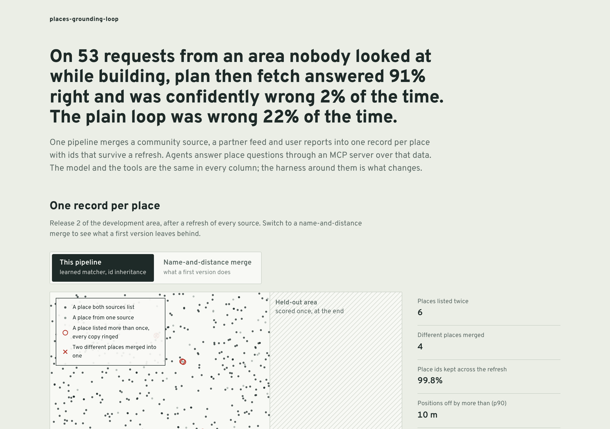

# places-grounding-loop

A location agent is only as good as two things: the place data under it, and the harness that keeps the model honest
about that data. This repository builds both and measures them together.

- **A places pipeline** that merges a community source, a partner feed and user reports into one record per real
  place, keeps place ids stable when the sources are refreshed, and closes a place only when two independent kinds of
  signal agree. Blocking runs locally or as a PySpark job; a test checks both give the same candidate pairs.
- **An MCP server** over the merged data: forward search, category search, place details, walking and driving routes,
  and the data version. Search is sharded; a shard can time out, and the result then says it is partial.
- **Three agent harnesses** around the same model and tools: the plain loop most first versions ship, a guarded loop,
  and plan-then-fetch. They are compared on the failure modes that hurt tool-calling agents in production: invented
  arguments, stale context, silent partial results, unbounded loops, and guessing between two equally good matches.
- **An evaluation that grows from production.** Production traffic is logged, users report bad answers (and sometimes
  good ones by mistake), a reviewer confirms, and every confirmed failure becomes a regression case that replays the
  request with the same tool behaviour. A gate in CI blocks a harness change that lowers task success, breaks a
  regression case, or makes latency or cost worse while over budget.



## Results

<!-- results:start -->
Held-out run (east area, 53 tasks × 3 repeats, run once at commit `ad8a5e5`):

| | Plain loop | Guarded loop | Plan then fetch | Target |
|---|---|---|---|---|
| Task success | 69.8% (60%–79%) | 90.6% (83%–98%) | **90.6%** (83%–98%) | |
| Confidently wrong answers | 22.0% | 1.9% | 1.9% | |
| Latency p50 / p95 per turn | 5.7 / 8.1 s | 2.4 / 6.7 s | 2.0 / 2.9 s | p95 ≤ 4.0 s |
| Cost per turn | €0.0147 | €0.0097 | €0.0057 | ≤ €0.01 |
| Model calls per turn | 3.75 | 3.83 | 2.27 | |

Failure modes that reached the user (share of held-out runs):

| | Plain loop | Guarded loop | Plan then fetch |
|---|---|---|---|
| Invented argument | 10.1% | 0.0% | 0.0% |
| Stale context | 5.7% | 0.0% | 0.0% |
| Silent partial result | 6.9% | 0.0% | 0.0% |
| Unbounded loop | 4.4% | 0.0% | 0.0% |
| Guessed between twins | 7.5% | 0.0% | 0.0% |

Pipeline, release 2 of the development area: 6 duplicate places against 222 for a name-and-distance merge, 4 wrong merges, place-id stability 99.75% against 49.4%; the naive release is blocked by the id-loss check (56.1% of ids lost). Held-out area: 3 duplicates, 0 wrong merges, stability 99.56%.

Feedback loop: 264 production requests on the plain loop, 85 failed, 47 reported by users (5 of them about right answers), 43 failures nobody reported, 34 regression cases kept. Plan then fetch passes 25 of 34; the rest are data gaps, not agent mistakes.

Gate on six changes (development tasks plus the regression cases):

| Change | Decision | Why |
|---|---|---|
| add the guards | passes | success +0.239 (lower bound +0.182), p95 6.6 s, €0.0100 |
| plan then fetch | passes | success +0.000 (lower bound +0.000), p95 3.0 s, €0.0059 |
| drop the freshness check (one status call less per turn) | blocked | task success may drop: paired difference -0.072, lower bound -0.110 below -0.02; fails 8 regression case(s) the current harness passes: REG-002, REG-017, REG-020, REG-022, REG-024 |
| cache without the version key (more cache hits) | blocked | task success may drop: paired difference -0.133, lower bound -0.197 below -0.02; fails 8 regression case(s) the current harness passes: REG-002, REG-017, REG-020, REG-022, REG-024 |
| send every request to the large model | blocked | p95 latency 4959 ms, over the 4000 ms budget and above the current 3024 ms; €0.0106 per request, over the €0.01 budget and above the current €0.0059 |
| skip partial-result retries (fewer tool calls) | passes | success +0.000 (lower bound +0.000), p95 3.1 s, €0.0059 |
<!-- results:end -->

## How each failure mode is produced and caught

The model is simulated: it reads the request and the observations in its context and proposes the next tool call or
the answer, making each mistake at the rate set in `config/pgl.toml [model]`. The harness only sees what the model
proposes, so every guard has to catch the mistake from evidence, the way it would with a real model.

| Failure mode | What the model does | What catches it |
|---|---|---|
| Invented argument (8%) | Skips the geocode and makes up coordinates, or calls `place_details` with a plausible id it never saw. Most invented ids exist, so the plain loop answers about the wrong place without an error. | Provenance: a coordinate pair or id must appear in an earlier tool result. Plans refer to earlier results (`$0.lat`) instead of copying values. |
| Stale context (60% of follow-ups) | Answers "is it still open?" from the details it read last turn. Between the turns the place closes or its hours change, as a live feed would. | Each turn reads the data version first and drops facts read at an older one. The cache key includes the version; without it, the cache serves the stale details itself (ablation below). |
| Silent partial result (70% of partials) | Treats a search with a timed-out shard as complete, and the nearest place may be in the lost shard. | Partial results are retried twice; a result that stays partial is disclosed in the answer. |
| Unbounded loop (50% of empty results) | Repeats a search that came back empty instead of widening it. | A call that already returned nothing is not run again; a step budget. In plan-then-fetch the plan says how to widen, so no model round trip is spent on it. |
| Guessing between twins (60%) | Takes the first of two places with the same name on the same street. Half of the "walk to X on Y street" requests in this world are ambiguous that way. | Two equally good matches mean asking which one; asking is scored as right on an ambiguous request and as no answer otherwise. |

## The pipeline

Two deliveries of a synthetic Berlin-sized city (1,400 places, 8% sharing a building, 12% chains): a community
source and a partner feed with coordinate noise, missing fields, renamed keys and different street spellings, plus
user reports (20% of them wrong) between deliveries.

- **Blocking** on a 120 m grid with the neighbouring cells, within 250 m: `pairs_local` and `pairs_spark` (PySpark,
  a cross join of nine cell offsets and a haversine filter) must produce the same pairs.
- **Matching** with a logistic regression on seven pair features (distance, trigram name similarity, normalised name
  key, house number, street, phone agreement and conflict), trained only on labelled pairs from the development area
  of release 1, then a greedy one-to-one assignment.
- **Fusion** with provenance: name, position and address from the community source when it has the place, hours
  and phone from the partner; the record says where each came from and flags positions where the sources disagree
  by more than 60 m.
- **Stable ids**: a merged place inherits the id that most of its source keys had in the previous release; without
  a shared key it inherits a previous id within 60 m with a similar name; otherwise a new id is minted.
- **Closures** need two kinds of signal: the partner or the community lists the place closed, or at least two users
  report it closed. One kind alone closed 19 open places in release 1 while building; with two, none.
- **Release checks** run without the world: confirmed by both sources, with hours, position disagreement, closures,
  and the share of ids that would change. Over 15%, the release is blocked.
- **Streaming events** (hours changes and closures) apply between releases and bump the data version.

Release 2 of the development area: 6 duplicates and 4 wrong merges in 899 places, positions within 10 m at p90, 99.75%
of ids kept. The name-and-distance merge a first version often ships leaves 222 duplicates and changes 56% of ids,
so its release is blocked. Run on that naive data, the guarded loop still answers 87.5% of the development tasks
right against 90.9% on this pipeline's data: duplicates of the same place often both give a right answer, so the
damage shows up first in ids that change under users and in positions off by 67 m at p90.

## What the numbers do and do not show

- **The world and the model are simulated.** Rates of each mistake come from config, not from a measured model; the
  large and small models differ only in latency, price and a 4-point higher error rate. The value of the harnesses is
  in catching each mistake from evidence, which carries over to a real model; the size of each effect does not.
- **Plan-then-fetch and the guarded loop have the same success** because they share the model's decisions and the
  guards. Plan-then-fetch wins on latency and cost: 2.3 model calls per turn instead of 3.8, independent calls in
  parallel, and widening done by the plan.
- **Some guards show no success gain here.** Without partial retries or the loop guard, task success does not move on
  these tasks, and "skip partial-result retries" passes the gate. A lost shard rarely held the nearest place; the
  loop guard mainly saves steps. The gate reports that rather than hiding it.
- **The remaining failures are data.** Of the 34 regression cases, plan-then-fetch passes 25; the other 9 are phone
  numbers no source carries and one post office whose partner hours say 10:00 when it opens at 9:00, so at 9:00 it
  looks closed. They go to the pipeline backlog.
- **Latency and cost are simulated** from config: model time from a base latency, input tokens and, without streaming,
  the answer's generation time; tool time with a spread.
- **What I saw of the held-out area before the run.** The world, including the east area and its tasks, was pinned
  before any pipeline code existed. While building the pipeline I printed its scores for the held-out area as well
  as the development area, and afterwards changed the closure rule (the change was driven by release-1 numbers in
  the development area). I also counted how many held-out ETA requests are ambiguous when deciding how to score asking
  back. No agent code was run on the held-out tasks before the single logged run in `reports/heldout-runs.log`.

## Run it

```bash
pip install -e ".[dev]"           # Spark needs Java 17
make test                         # 28 tests, about 35 s
make eval                         # development evaluation -> reports/dev.json, about 9 minutes
make gate                         # [gate].candidate against [gate].current; exit 1 when blocked
python scripts/gate.py "drop the freshness check (one status call less per turn)"   # blocked
make report                       # results.json, RESULTS.md, this README's block, the dashboard's data
cd web && npm ci && npm run dev   # the dashboard
```

The places server speaks MCP over stdio:

```json
{ "mcpServers": { "places": { "command": "python", "args": ["-m", "pgl.servers.places"], "env": { "PYTHONPATH": "src" } } } }
```

or `docker build -t pgl . && docker run -i pgl`.

## Layout

| Path | What |
|---|---|
| `scripts/build_world.py` | The world: two deliveries from three sources, landmarks, agent tasks and their accepted answers |
| `src/pgl/pipeline/` | Normalisation, blocking (local and Spark), features, matching, fusion, ids, closures, release checks, events |
| `src/pgl/training/` | Trains the matcher on development-area pairs of release 1 |
| `src/pgl/servers/places.py` | The MCP server and the tool logic behind it |
| `src/pgl/agents/` | The simulated model and the three harnesses, their guards and the gate's candidate changes |
| `src/pgl/evals/` | Pipeline and task scoring, statistics, the feedback loop and the gate |
| `evalcases/regressions.jsonl` | Regression cases mined from production failures |
| `logs/production.jsonl` | What production saw: requests, traces, answers, user reports; no verdicts |
| `web/` | The dashboard: React, TypeScript and Framer Motion |

See `reports/RESULTS.md` for the development numbers, the failure-mode table, the feedback funnel and every gate
decision.
